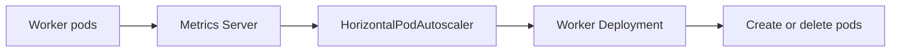
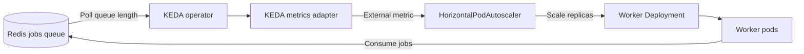
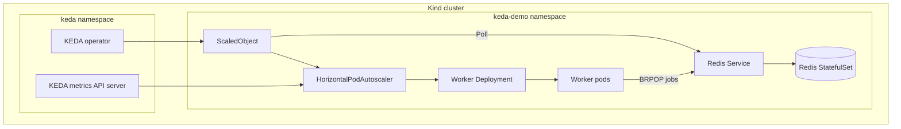

# Local KEDA Redis Autoscaling Demo

A UI-free Kubernetes project that demonstrates event-driven autoscaling with [KEDA](https://keda.sh/) on a local macOS Kubernetes cluster.

The project uses:

- Redis as a queue and persistent application state
- A Python worker `Deployment`
- A Redis `StatefulSet`
- A KEDA `ScaledObject`
- Docker Desktop and Kind for local Kubernetes
- Helm for installing KEDA

## Table of contents

- [What is KEDA?](#what-is-keda)
- [Kubernetes scaling without KEDA](#kubernetes-scaling-without-keda)
- [Kubernetes scaling with KEDA](#kubernetes-scaling-with-keda)
- [Architecture](#architecture)
- [How the Redis example works](#how-the-redis-example-works)
- [Requirements](#requirements)
- [Create and run the demo](#create-and-run-the-demo)
- [Test autoscaling](#test-autoscaling)
- [Scaling behavior](#scaling-behavior)
- [Project files](#project-files)
- [Useful commands](#useful-commands)
- [Troubleshooting](#troubleshooting)
- [Cleanup](#cleanup)

## What is KEDA?

**KEDA**, or Kubernetes Event-driven Autoscaling, adds event-based autoscaling to Kubernetes workloads.

A normal Kubernetes `HorizontalPodAutoscaler` commonly responds to CPU or memory metrics. KEDA can additionally scale workloads according to external event sources, including:

- Redis list or stream length
- RabbitMQ queue length
- Kafka consumer lag
- AWS SQS queue length
- Azure Storage Queue length
- Cron schedules
- Database records
- Prometheus metrics
- Many other supported scalers

KEDA integrates with Kubernetes by:

1. Polling an external event source.
2. Translating event demand into metrics.
3. Feeding those metrics to Kubernetes HPA.
4. Scaling the target Deployment or Job.
5. Supporting scale-to-zero and scale-from-zero.

### Core KEDA resources

| Resource | Purpose |
|---|---|
| `ScaledObject` | Connects a Deployment or StatefulSet to event triggers |
| `ScaledJob` | Creates Kubernetes Jobs in response to events |
| `TriggerAuthentication` | Supplies credentials without placing secrets directly in a trigger |
| KEDA Operator | Activates workloads and manages scaling resources |
| KEDA Metrics Adapter | Provides external metrics to Kubernetes |

## Kubernetes scaling without KEDA

Without KEDA, Kubernetes scaling is normally based on resources or custom metrics configured outside KEDA.

A Deployment defines the desired number of replicas:

```yaml
spec:
  replicas: 1
```

A CPU-based HPA might look like this:

```yaml
apiVersion: autoscaling/v2
kind: HorizontalPodAutoscaler
metadata:
  name: queue-worker
spec:
  minReplicas: 1
  maxReplicas: 10
  scaleTargetRef:
    apiVersion: apps/v1
    kind: Deployment
    name: queue-worker
  metrics:
    - type: Resource
      resource:
        name: cpu
        target:
          type: Utilization
          averageUtilization: 50
```



### Limitations

- CPU or memory may not represent queue demand.
- A pod can have low CPU while thousands of jobs remain queued.
- Redis, RabbitMQ, Kafka, AWS, and Azure queue state is not automatically understood.
- Scale-to-zero requires custom logic or additional controllers.
- Custom metric infrastructure can require significant configuration.

## Kubernetes scaling with KEDA

KEDA adds event polling and activation on top of Kubernetes autoscaling.



The flow is:

1. A job is pushed into Redis.
2. KEDA polls Redis at regular intervals.
3. KEDA calculates or reports queue demand.
4. Kubernetes HPA calculates the required replica count.
5. The Deployment creates worker pods.
6. Workers consume jobs from Redis.
7. KEDA observes that demand has returned to zero.
8. After the cooldown period, the Deployment scales to zero.

## Architecture



### Components

| File | Kubernetes resource | Purpose |
|---|---|---|
| `app/namespace.yaml` | Namespace | Isolates the demo in `keda-demo` |
| `app/redis.yaml` | StatefulSet and Service | Provides persistent Redis queue storage |
| `app/worker.yaml` | Deployment | Runs Python queue workers |
| `app/scaledobject.yaml` | ScaledObject | Watches Redis and controls worker replicas |
| `app/Dockerfile` | Docker image | Builds the Python worker image |
| `app/worker.py` | Python worker | Processes Redis queue jobs |

## How the Redis example works

### 1. Redis stores the queue

Redis stores jobs in a list named `jobs`:

```text
LPUSH jobs job-1
LPUSH jobs job-2
LPUSH jobs job-3
```

The Python worker removes jobs using `BRPOP`:

```python
job = client.brpop(queue_name, timeout=5)
```

This makes Redis a competing queue: each worker can remove a job for processing, and each Redis list item is normally consumed by only one worker.

### 2. KEDA polls Redis

The ScaledObject in `app/scaledobject.yaml` is configured as follows:

```yaml
triggers:
  - type: redis
    metadata:
      address: redis.keda-demo.svc.cluster.local:6379
      listName: jobs
      listLength: "1"
      enableTLS: "false"
```

The settings mean:

- `address`: Redis Kubernetes DNS name and port
- `listName`: Redis list to inspect
- `listLength`: Desired queue items per worker
- `enableTLS`: Disable TLS because local Redis does not use TLS
- `pollingInterval`: KEDA checks Redis every five seconds
- `cooldownPeriod`: Wait 15 seconds after demand ends before scaling down

### 3. KEDA calculates replicas

If 20 jobs are queued and one replica is expected to handle one job:

$$
\text{desired replicas} = \left\lceil\frac{20}{1}\right\rceil = 20
$$

The demo has a maximum of 10 replicas:

```yaml
maxReplicaCount: 10
```

Therefore, 20 queued jobs result in 10 workers.

### 4. KEDA scales from zero

Initially, the worker Deployment is configured with:

```yaml
replicas: 0
```

and the ScaledObject has:

```yaml
minReplicaCount: 0
```

Once queue length becomes greater than zero, KEDA activates the target and increases the replica count.

```text
0 workers -> 1 or more workers
```

### 5. Workers process jobs

The worker performs these steps:

1. Connect to Redis.
2. Wait for a job using `BRPOP`.
3. Print the job it is processing.
4. Simulate processing for two seconds.
5. Print completion.
6. Repeat or remain waiting.

Redis queue length decreases as workers consume jobs.

### 6. KEDA scales back to zero

When Redis queue length remains zero for the configured cooldown period, KEDA scales the Deployment back to zero:

```text
workers running -> 0 workers
```

The Redis StatefulSet remains running because it stores the queue and data.

## KEDA with and without KEDA

| Feature | Kubernetes only | Kubernetes with KEDA |
|---|---|---|
| CPU autoscaling | Yes | Yes |
| Memory autoscaling | Yes | Yes |
| Redis queue scaling | No direct support | Yes |
| Kafka lag scaling | No direct support | Yes |
| Scale from zero | Limited | Yes |
| Scale to zero | Usually requires custom setup | Yes |
| AWS/Azure queue scaling | Requires custom metrics | Yes |
| Cron scheduling | Requires additional controller | Yes |
| External credential management | Not built into HPA | TriggerAuthentication |
| Kubernetes HPA resource | User creates it | KEDA manages it |

## Requirements

For this macOS demo:

- macOS
- Docker Desktop
- Homebrew
- `kubectl`
- `helm`
- Kind

Docker Desktop must be running before setup.

The runner script attempts to install missing `kubectl`, Helm, and Kind tools with Homebrew.

## Create and run the demo

Start Docker Desktop, open Terminal in the repository root, and run:

```bash
chmod +x app/run-mac.sh app/build-and-load.sh app/test-mac.sh app/cleanup-mac.sh
app/run-mac.sh
```

The runner performs these technical steps:

1. Checks Homebrew.
2. Checks Docker Desktop.
3. Checks or installs `kubectl`, Helm, and Kind.
4. Creates or reuses the `keda-demo` Kind cluster.
5. Selects the `kind-keda-demo` Kubernetes context.
6. Installs KEDA in the `keda` namespace.
7. Builds the Python worker image.
8. Loads the image into Kind.
9. Applies the namespace.
10. Deploys Redis.
11. Deploys the worker with zero replicas.
12. Applies the KEDA ScaledObject.

### Manual setup

A manual setup is also possible:

```bash
kind create cluster --name keda-demo
kubectl config use-context kind-keda-demo

helm repo add kedacore https://kedacore.github.io/charts
helm repo update
helm upgrade --install keda kedacore/keda --namespace keda --create-namespace --wait

app/build-and-load.sh --cluster keda-demo

kubectl apply -f app/namespace.yaml
kubectl apply -f app/redis.yaml
kubectl apply -f app/worker.yaml
kubectl apply -f app/scaledobject.yaml
```

## Test autoscaling

### 1. Verify deployment state

```bash
kubectl -n keda-demo get deployment queue-worker
kubectl -n keda-demo get pods
kubectl -n keda-demo get scaledobject
kubectl -n keda-demo get hpa
```

The worker should initially have zero replicas.

### 2. Push jobs

Push 20 jobs:

```bash
app/test-mac.sh
```

Push a custom number:

```bash
app/test-mac.sh 50
```

### 3. Watch worker replicas

```bash
kubectl -n keda-demo get deployment queue-worker --watch
```

The replica count should increase based on queue length and remain limited to 10.

### 4. Watch worker logs

```bash
kubectl -n keda-demo logs -l app=queue-worker -f --all-pods=true
```

Logs should show workers processing jobs.

### 5. Inspect Redis

Run an interactive Redis client:

```bash
kubectl -n keda-demo run redis-check --rm -it --restart=Never \
  --image=redis:7-alpine -- redis-cli -h redis
```

Useful Redis commands:

```text
LLEN jobs
LRANGE jobs 0 -1
```

Exit with:

```text
exit
```

### 6. Watch scaling resources

```bash
kubectl -n keda-demo get scaledobject,hpa
kubectl -n keda-demo describe scaledobject queue-worker-scaler
kubectl -n keda-demo describe hpa keda-hpa-queue-worker-scaler
```

The exact HPA name may vary, so use:

```bash
kubectl -n keda-demo get hpa
```

### 7. Verify scale to zero

After all jobs are processed, wait at least 15 seconds, then run:

```bash
kubectl -n keda-demo get deployment queue-worker
```

It should return to zero replicas.

## Scaling behavior

| Queue length | Target queue length | Calculated replicas | Maximum applied |
|---:|---:|---:|---:|
| 0 | 1 | 0 | 0 |
| 1 | 1 | 1 | 1 |
| 5 | 1 | 5 | 5 |
| 20 | 1 | 20 | 10 |

With `cooldownPeriod: 15`, the replica count does not immediately change to zero merely because Redis becomes empty for one poll.

## Project files

```text
.
├── README.md
├── LICENSE
├── scrap
└── app
    ├── Dockerfile
    ├── MACOS.md
    ├── README.md
    ├── build-and-load.sh
    ├── cleanup-mac.sh
    ├── namespace.yaml
    ├── redis.yaml
    ├── run-mac.sh
    ├── scaledobject.yaml
    ├── test-mac.sh
    ├── worker.py
    └── worker.yaml
```

## Useful commands

### KEDA resources

```bash
kubectl -n keda get pods
kubectl -n keda get deployments
kubectl -n keda get crd | grep keda
```

### Demo resources

```bash
kubectl -n keda-demo get all
kubectl -n keda-demo describe deployment queue-worker
kubectl -n keda-demo describe statefulset redis
kubectl -n keda-demo describe scaledobject queue-worker-scaler
```

### Worker logs

```bash
kubectl -n keda-demo logs -l app=queue-worker --all-pods=true
```

### Kubernetes events

```bash
kubectl -n keda-demo get events --sort-by=.lastTimestamp
```

## Troubleshooting

### Docker is not running

Start Docker Desktop and wait until Docker reports that it is running.

```bash
docker info
```

### Kind is missing

```bash
brew install kind
```

### kubectl is missing

```bash
brew install kubectl
```

### Helm is missing

```bash
brew install helm
```

### Worker remains at zero replicas

Check that:

- KEDA is running in the `keda` namespace.
- Redis is ready.
- The ScaledObject is active.
- Redis can be reached by the worker and KEDA.
- Jobs are added to the `jobs` list.

```bash
kubectl -n keda get pods
kubectl -n keda-demo get pods
kubectl -n keda-demo get scaledobject queue-worker-scaler -o yaml
```

### Worker image is not found

For Kind, rebuild and load the image:

```bash
app/build-and-load.sh --cluster keda-demo
kubectl -n keda-demo rollout restart deployment queue-worker
```

### Cluster context is wrong

```bash
kubectl config use-context kind-keda-demo
kubectl cluster-info
```

### Redis pod is not ready

```bash
kubectl -n keda-demo get pods
kubectl -n keda-demo describe pod redis-0
kubectl -n keda-demo logs redis-0
```

## Cleanup

Use the macOS cleanup script:

```bash
app/cleanup-mac.sh
```

Manual cleanup:

```bash
kubectl delete namespace keda-demo
helm uninstall keda --namespace keda
kubectl delete namespace keda
kind delete cluster --name keda-demo
```

## Design considerations

### Scale-to-zero

Scale-to-zero prevents idle workers from consuming cluster resources. It is appropriate when cold starts are acceptable and work can wait in an external queue.

Scale-to-one behavior may be preferable for low-latency workloads that should always remain available.

### Queue ownership

Workers should not store job state inside their container filesystem. Redis or another persistent service should own the queue and worker-visible state.

### Retries and duplicate processing

A worker crash can prevent an acknowledged job from completing. Production workers should:

- Use explicit acknowledgements or atomic queue operations
- Implement retries
- Treat processing as idempotent
- Use dead-letter queues
- Add timeouts and health checks

This local demo intentionally simulates processing in a simple loop and does not implement these production reliability requirements.